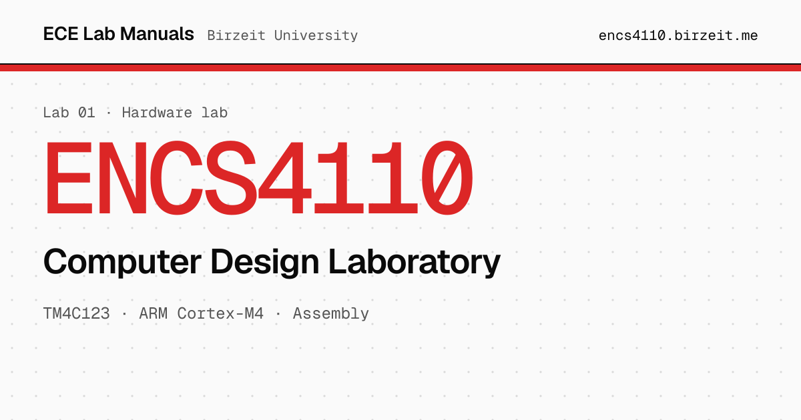

<a href="https://encs4110.birzeit.me"></a>

# ENCS4110 · Computer Design Laboratory

Step-by-step lab manual for ENCS4110 at Birzeit University: the ARM Cortex-M4 from the inside (registers, instruction set and assembly), then put to work on the TM4C123 Tiva C LaunchPad with GPIO, interrupts, timers, ADC and UART.

**[Open the manual](https://encs4110.birzeit.me)** · [PDF](https://encs4110.birzeit.me/manual/encs4110_manual.pdf) · [Setup guide](https://encs4110.birzeit.me/setup) · [All labs](https://birzeit.me)

## Run it locally

Requires [Node.js](https://nodejs.org) 24 and npm. The PDFs come from a submodule, so clone recursively:

```sh
git clone --recurse-submodules https://github.com/ECE-Birzeit/encs4110.git
cd encs4110
npm ci
npm run docs:dev   # http://localhost:5173, reloads as you edit
```

```sh
npm run docs:build       # outputs to docs/.vitepress/dist
npm run docs:preview     # serve the built site on port 8080
npm run smoke-test:pwa   # check the offline (PWA) build, run after docs:build
```

Already cloned without the submodule? Run `git submodule update --init`.

## Project layout

| Path | Contents |
|:--|:--|
| `docs/index.md` | Home page |
| `docs/setup.md` | Keil uVision5 and LaunchPad setup |
| `docs/experiments/` | One page per experiment (`1.md` … `10.md`) and the index |
| `docs/*-assignment.md` | Assignment pages (keypad, LED stopwatch, Simon, traffic light) |
| `docs/snippets/` | Code included into pages |
| `docs/public/manual/` | Submodule: the `pdf` branch of [encs4110-manual](https://github.com/ECE-Birzeit/encs4110-manual) |
| `docs/.vitepress/config.mts` | Site config: nav, sidebar, PWA, analytics, link previews |
| `scripts/smoke-test-pwa.mjs` | Checks the service worker and offline manifest |

### Updating the PDFs

The PDFs are built in [encs4110-manual](https://github.com/ECE-Birzeit/encs4110-manual) and published to its `pdf` branch. To pull the latest into this site:

```sh
git submodule update --remote docs/public/manual
git add docs/public/manual
git commit -m "Update manual PDFs"
```

## Contributing

Found a mistake? Click **Edit this page on GitHub** at the bottom of any page, or [open an issue](https://github.com/ECE-Birzeit/encs4110/issues/new/choose). Problems in the PDF itself belong in [encs4110-manual](https://github.com/ECE-Birzeit/encs4110-manual/issues/new/choose). The [contributing guide](https://github.com/ECE-Birzeit/.github/blob/main/CONTRIBUTING.md) covers writing style and pull requests.

## Deployment

`.github/workflows/deploy.yml` builds the site, runs the PWA smoke test, and deploys to GitHub Pages on every push to `main`, so merged changes are live within a couple of minutes at [encs4110.birzeit.me](https://encs4110.birzeit.me). The old domain, `encs4110.me`, redirects there through [encs4110-redirect](https://github.com/ECE-Birzeit/encs4110-redirect).

---

<sub>Part of [ECE Lab Manuals](https://birzeit.me) · Maintained by [Mohammad Abu-Shelbaia](https://github.com/mabushelbaia)</sub>
